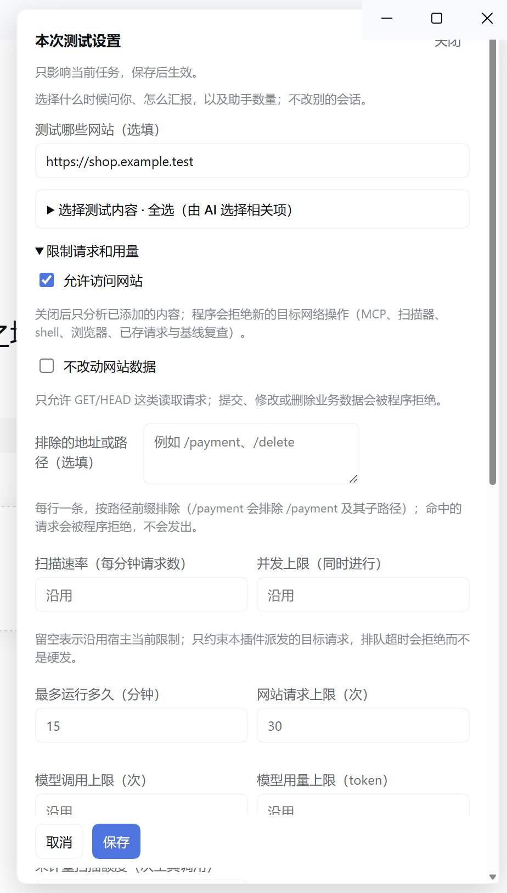
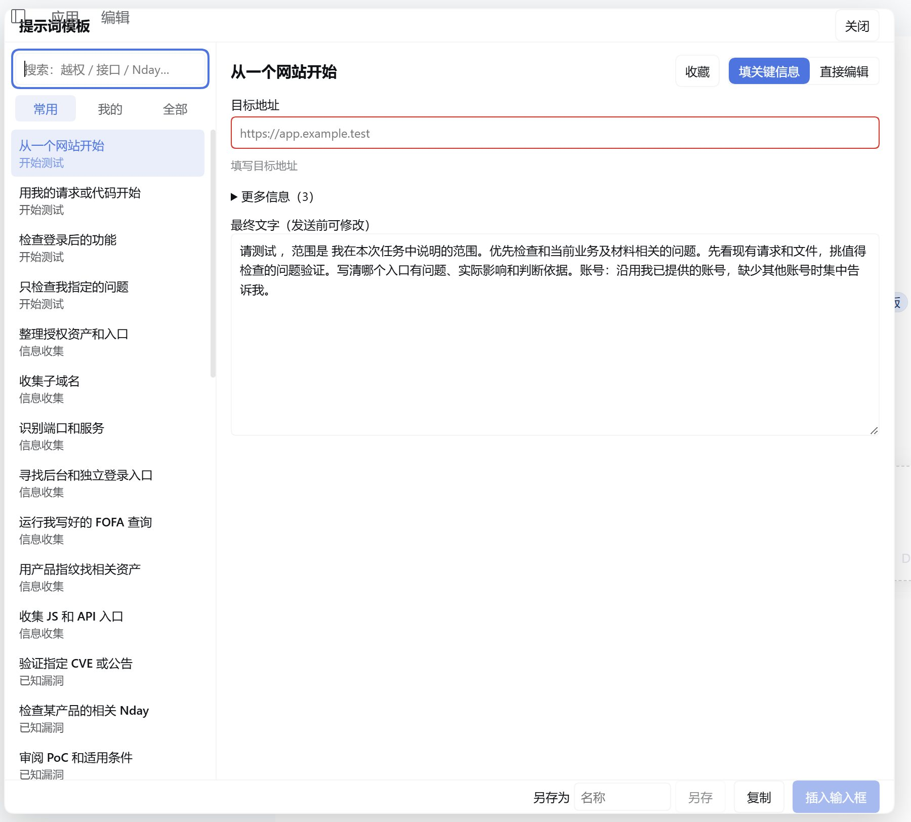
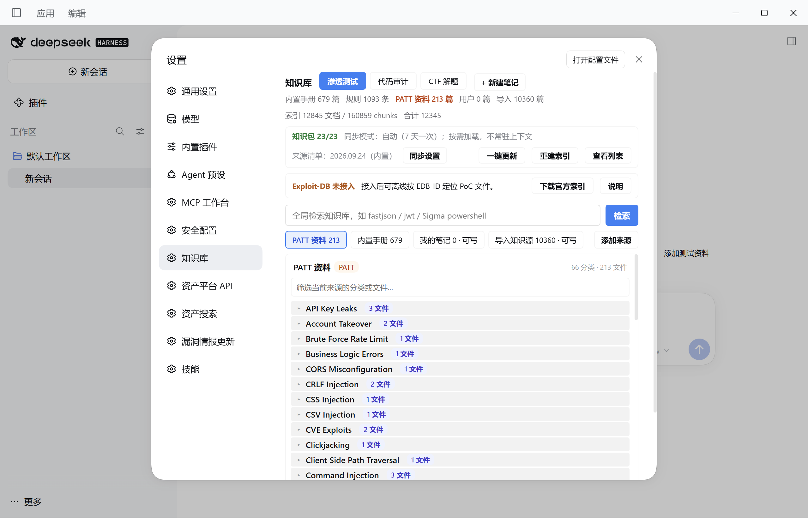
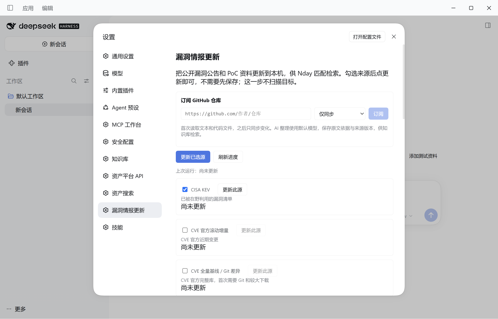
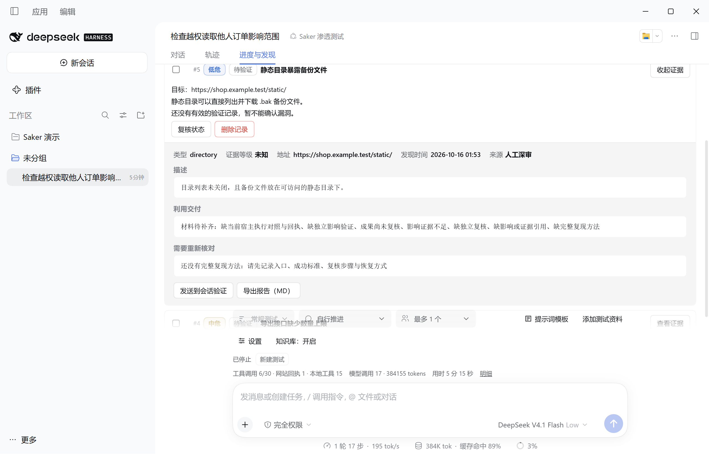
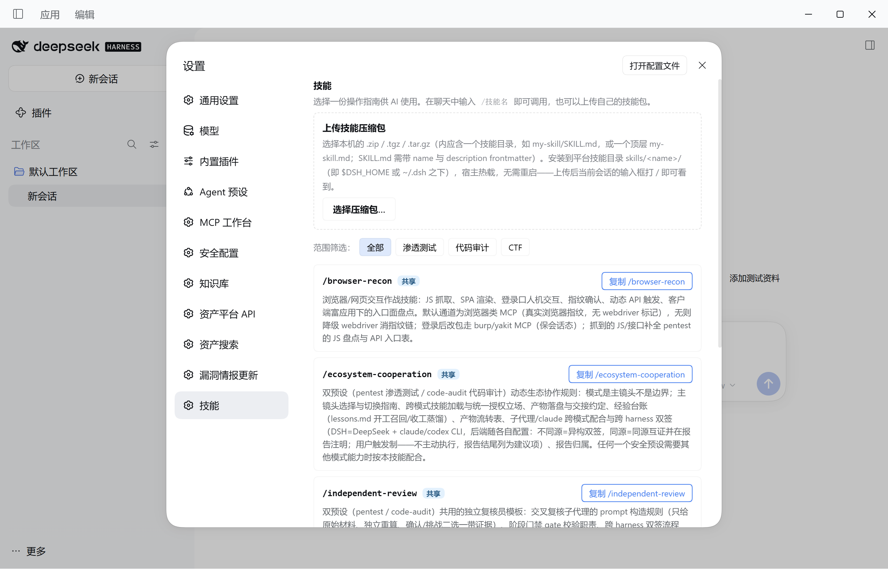

# Saker · 猎隼

> 把已经写好的测试要求，直接变成一次能持续推进的测试。

Saker 是运行在 [DeepSeek Harness Desktop](https://github.com/deepseek-ai/deepseek-harness) 上的 AI 安全测试工作台。它把聊天、测试文档、真实浏览器、执行记录、证据复核和报告整理放进同一个会话：你给出目标和材料，Saker 按你的文档连续执行，缺条件的项写清缺口，其余继续。

[下载最新版](https://github.com/ITroyeSivan/Saker/releases/latest) · [安装说明](docs/getting-started.md) · [功能说明](docs/features.md) · [插件清单](docs/plugin-list.md) · [边界与约束](docs/boundaries.md) · [问题反馈](https://github.com/ITroyeSivan/Saker/issues)

## 亮点

| | 能力 | 说明 |
|---|---|---|
| 📄 | **按文档测试** | 直接读 Word、Excel 和文本要求，按原文连续执行，不用把文档重写成提示词 |
| 🧭 | **三种实战方向** | 常规测试、Nday 发现、0Day 挖掘共享站点、身份、请求、资料和研究记录 |
| 🌐 | **受管真实浏览器** | 用 Chrome for Testing 观察、点击、输入、上传下载并读取相关请求，不拿一次性探针冒充完整执行 |
| ⛓️ | **连续执行** | 模型提前收口时按真实进度自动接续；同一进度没有新进展就暂停，不反复空转 |
| 🧾 | **证据与复测** | 执行回执、正常功能对照、复测三结论、报告脱敏导出和归档恢复 |
| 🧰 | **复用已有能力** | 知识库、Burp / Yakit MCP、本机扫描器按当前问题调用，不整库注入 |

## 两种起点

### 按文档测试

添加项目说明、测试文档、账号、请求或代码，写一句"按文档顺序执行"。Saker 会读取原文、整理要检查的内容，然后连续推进：

- 文档写了步骤和预期，就按原要求完成；页面变化时适配定位与操作。
- 文档只写了目标，就结合页面、请求和业务逻辑选择检查办法。
- 缺第二个账号时写清缺口，继续不依赖它的内容，不整批等待。
- 结束后直接看到哪里有问题、哪里检查过、哪里还没完成。


*测试进度按「文档要求 / 结果 / 说明」列出；结果区分发现问题、未发现问题、需进一步确认、缺少条件和未开始。*

### 实战挖掘

从一个具体问题开始，例如"检查普通账号能否读取其他人的订单"。三个方向共用同一个聊天入口。

| 方向 | 适合的问题 |
|---|---|
| 常规测试 | 接口、权限、对象边界和业务流程中的常见漏洞 |
| Nday 发现 | 根据已有产品证据查少量相关公开漏洞，核对版本与触发条件 |
| 0Day 挖掘 | 沿业务疑点追页面、JS、请求和必要源码，比较实际处理结果 |


*入口：聊天框上方「设置 → 开始任务与预算」。*

## 一次按文档测试怎么走

1. **添加资料**：Word、Excel、HAR、curl、JS、扫描结果和资产清单都可以；保存原文、来源和版本，不立刻发送或访问网站。
2. **说明限制**：允许访问的网站、排除路径、不做哪些操作、时间与模型用量。
3. **明确开始**：点击开始或发送明确的开始指令，先建立本次运行和用量归属，再理解文档并执行。
4. **连续检查**：正常登录和已找到的业务入口在条件仍有效时继续使用；缺条件项单独列出，独立项继续。
5. **导出结果**：报告、检查表、来源清单一次导出；导出只整理已保存事实，不重新访问目标。


*入口：聊天框上方「添加测试资料」；本任务资料统一在「进度与发现 → 测试资料」查看。*

## 你决定参与多少

有时间一起分析，就选「共同研判」；希望在关键步骤再确认，就选「关键节点确认」；希望 AI 按约定自行推进，就选「自主推进」。进度消息可以选每阶段简报或结束时汇总。

助手默认「自动，最多 2 个」，上限按宿主实际支持范围显示（官方 Desktop 默认 **0–8**，最高 16）。小任务只用主代理；需要隔离大量材料或承担明确的深入工作时再分派，同站复用，结束释放。



*入口：聊天框上方的模式、协作、助手按钮和「设置」，不用离开当前会话。*

## 测试内容与执行边界

默认全选 17 项 Web 核心内容：子域名、端口服务、指纹、目录、JS/API、访问控制、业务逻辑、SQL 注入、XSS、SSRF、文件上传、文件读取、命令注入、模板注入、反序列化、XXE、JWT/会话。你可以排除不需要的方向；全部不选时不再发起新的目标访问。CORS 与开放重定向默认不检查。

设置里可以指定允许访问的网站、排除路径、请求速率和并发；保存后才生效，并且只影响当前任务。IP 封禁、正常访问失效、登录过期和实际工具限制会停止受影响请求，说明依据和未覆盖内容。

## 不知道怎么提问，就从模板改起

内置 36 篇模板，按「开始测试 / 信息收集 / 已知漏洞 / 深入研究 / 分析资料 / 结果与继续」分组。选一篇后只填 0–2 个关键字段，「最终文字」始终可见、可改；可以复制、插入聊天，或另存为个人模板。模板不会自动发送，也不会自动拼入整库。



*入口：聊天框上方「提示词模板」。*

## 知识库

知识库统一检索内置漏洞资料、产品版本条件、公告、PATT 资料、个人笔记和导入内容。测试时按需限量检索相关内容，不把整库塞进请求；关闭后停止新的知识读取，历史仍可查看。任务文档读取与知识开关相互独立：关掉知识库不影响读取你交付的测试要求。



*入口：应用设置 → 知识库。*

## 工具与 MCP

在「安全配置」里管理本机扫描、分析工具的路径、可用性和启动方式，包括受管 Chrome for Testing 的路径。已有 Burp、Yakit 等 MCP 服务可以继续接入，在「MCP 工作台」查看连接状态、可用工具和调用记录。目标测试优先走真实浏览器或 Saker 的可计量请求入口，避免用 shell curl 丢请求头造成误判。


*入口：应用设置 → 安全配置。*


*入口：应用设置 → MCP 工作台。外部工具与 MCP 服务需要单独安装和配置。*

## Nday 情报更新

订阅 GitHub 漏洞仓库和公开漏洞来源，查看新内容与更新记录。来源更新与目标测试分开进行；测试时再按目标查找少量相关候选漏洞，核对版本和触发条件。没有公开编号也不自动认定为首次发现。



*入口：应用设置 → 漏洞情报更新。*

## 执行记录与复测

执行记录保存实际模型调用、工具调用、目标请求、状态和费用依据；失败、取消、未派发和未知分开记录。工具动作没有回执时不会消失。

复测结论只有三种：**仍可复现 / 本次未复现 / 无法确认**。

- 「仍可复现」必须引用本次实际执行回执。
- 「本次未复现」还要同时引用同一次复测的正常功能对照回执（同源、同身份、2xx）；单独一张目标回执不能证明修复。
- 登录失效、限流和服务端错误只能记「无法确认」；403/404 只有在正常功能对照仍可用时才支持未复现。
- 回执是否仍有效看当前请求、身份、目标实例和内容完整性，不按固定时间一刀切；留档时间由服务器决定。

每次复测新建版本记录，不覆盖原发现；标记「已修复」必须依据最新一次带对照的未复现记录。字段更新与复测留档同一次提交，任一步失败都不留半更新。

## 发现、复核与报告

「进度与发现」集中查看本轮在查什么、已确认的问题、待验证线索和还缺哪些证据。发现详情列出请求、身份、对象、实际影响、复现步骤和证据引用；缺宿主执行对照、独立影响验证或完整复现方法时，状态停在待验证，不进报告。


*入口：进度与发现 → 发现的问题。*



*发现详情逐项列出还缺什么，补不齐就不进报告。*

报告可以预览、脱敏和导出；报告助手只整理已有材料，不借此新测目标。任务停止后保留资料，后续可以继续核对和补充；归档用于保存历史，恢复前先核对当前数据与正常基线。

## 技能

技能适合保存一套操作指南，在聊天中用 `/技能名` 调用，也可以上传自己的技能包。



*入口：应用设置 → 技能；调用入口：聊天输入框中的 `/`。*

## 安装

当前版本 **0.4.109**，适用于官方 Windows Desktop **0.2.1-rc.2**（同时兼容 0.2.0-rc.2）。

1. 安装官方 Desktop，完成初始化和模型配置，然后完全退出应用。
2. 从 [Releases](https://github.com/ITroyeSivan/Saker/releases/latest) 下载 `Saker-0.4.109-desktop.zip`，解压到长期保留的目录。
3. 在解压目录执行，把路径替换为 Desktop 安装目录：

```powershell
node scripts/install-desktop.mjs --desktop-dir "C:/path/to/DeepSeek Harness"
```

安装器检查全部 20 个包，并用官方 CLI 安装到 `desktop` profile；需要 Web profile 时加 `--profile web`。安装后会在桌面创建或刷新 **Saker (dsh Desktop)** 快捷方式。更新沿用原来的用户数据、会话和 MCP 配置；请保留解压目录，安装后的 profile 依赖其中的 `dist/desktop` 产物。脚本需要 Node.js ≥22.5。

更完整的安装、升级与恢复说明见 [安装说明](docs/getting-started.md)。

## 项目状态与边界

项目处于快速迭代阶段，暂不建议投入实际业务，仅限个人学习、本地实验和已获授权的安全测试。请在你自行搭建或明确获授权的环境中使用；Saker 不负责获取测试授权，也不附带商业扫描器、本机 CLI、模型服务或第三方平台额度。

扫描结果和模型结论都可能误判，涉及真实系统的处置应由安全人员复核。本地配置和任务产物可能含 API Key、Token、请求报文和源码信息；公开日志或截图前请脱敏，不要提交个人 `.dsh` 目录。更多边界见 [边界与约束](docs/boundaries.md)。

Saker 自有代码采用 [MIT](LICENSE)，随附资料许可见 [第三方说明](THIRD_PARTY_NOTICES.md)。源码构建及贡献方式见 [开发说明](docs/development.md)。
