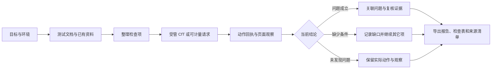

<p align="center">
  
</p>

<h1 align="center">Saker · 猎隼</h1>

<p align="center"><strong>不止会聊测试，而是把每项要求推进到有出处、有动作、有结论。</strong></p>

<p align="center">
  <a href="https://github.com/ITroyeSivan/Saker/releases/latest"></a>
  
  
</p>

<p align="center">
  <a href="https://github.com/ITroyeSivan/Saker/releases/latest"><strong>下载</strong></a>
  ·
  <a href="docs/getting-started.md">安装</a>
  ·
  <a href="docs/features.md">功能</a>
  ·
  <a href="docs/boundaries.md">边界</a>
  ·
  <a href="https://github.com/ITroyeSivan/Saker/issues">反馈</a>
</p>

Saker 是运行在 [DeepSeek Harness Desktop](https://github.com/deepseek-ai/deepseek-harness) 上的安全测试工作台。它把目标、测试要求、受管浏览器、请求回执、检查结论和导出材料放在同一个会话里，既支持按现有文档逐项检查，也支持 SRC、护网和授权研究中的具体问题。

## 为什么是 Saker

| 常见问题 | Saker 的处理 |
| --- | --- |
| **文档看了，检查却散在聊天里** | Word、Excel 和文本在本地解析；要求、位置、修订和检查状态进入同一条项目运行线 |
| **只看到“已完成”，不知道实际做了什么** | 检查绑定真实动作、观察或问题引用；失败、缺条件和复用观察分别记录 |
| **浏览器点得到，范围和证据却说不清** | 受管 Chrome for Testing 通过 CDP 工作，请求在发出前检查目标范围；不拿 curl 猜测浏览器结果 |
| **任务很长，恢复后容易重复或漏账** | 暂停、继续、旧队列失效、未知写入核对、历史运行和离线导出都有独立状态 |
| **报告要重跑一遍才能生成** | 从已保存的来源快照、回执、检查项和问题生成报告，导出本身不访问目标 |

## 一条完整的测试闭环



任务状态行直接显示已完成数量、当前检查、问题数、暂停或继续、历史运行和导出入口。点击“查看检查表”即可看到原文要求、结果以及实际做了什么或缺少什么，不需要进入设置区寻找。


## 两种工作起点

### 按文档测试

适合验收单、测试用例、检查清单、业务规则和已有环境说明。

1. 添加 `.docx`、`.xlsx` 或文本，查看解析位置和警告。
2. 模型把来源整理成检查项，不要求固定表头。
3. 每项通过受管浏览器或可计量请求执行，并保留对应回执和观察。
4. 缺账号、缺对象或正文不可得时记录具体条件，其它检查继续。
5. 结束后查看检查表、问题记录和离线交付包。

### 实战挖掘

面向 SRC 挖掘、护网和授权研究，保留三种明确方向：

| 方向 | 适用场景 |
| --- | --- |
| **常规测试** | 围绕账号、对象、权限、参数和业务步骤做对照验证 |
| **Nday 发现** | 根据产品或版本线索核对公开漏洞、适用条件与实际影响 |
| **0Day 挖掘** | 沿页面、JS、接口或源码中的具体疑点继续验证 |

可以从目标地址开始收集入口，也可以直接使用已有账号、接口、HAR、curl 或扫描结果。提示词模板用于快速组织问题；模板可搜索、编辑、复制和插入输入框，发送前始终由你确认。

## 从资料到交付

| 阶段 | 你可以看到什么 |
| --- | --- |
| **添加资料** | 文件、请求、HAR、curl、JS 和扫描结果分别保存；查看不会自动发送给模型 |
| **开始任务** | 目标、允许范围、排除路径、身份、速率、预算和协作方式 |
| **执行检查** | 当前检查、真实动作、浏览器观察、HTTP 回执、失败与未知写入 |
| **复核结论** | 正常对照、异常观察、对象归属、finding 引用和待补证据 |
| **导出结果** | Markdown 报告、检查表、来源清单、附件和 manifest |

<table>
  <tr>
    <td width="50%"></td>
    <td width="50%"></td>
  </tr>
  <tr>
    <td align="center"><strong>任务与预算</strong></td>
    <td align="center"><strong>测试资料</strong></td>
  </tr>
</table>

## 真实浏览器，不是命令行猜测

Saker 使用独立的 Chrome for Testing，通过 CDP 打开、观察、点击、填写、上传下载、处理弹窗和读取相关请求。浏览器路径可在 **应用设置 → 安全配置 → 工具 → Chrome for Testing** 中修改，也可由桌面启动配置指定。

需要浏览器语义的目标请求优先走受管浏览器；不使用 shell curl 代替浏览器自动添加的 Cookie、请求头、重定向、脚本执行和页面状态。确需直接请求时，走 Saker 的可计量 HTTP 入口并保留回执。

可接入 Burp、Yakit 和其他 MCP 服务。配置存在不等于服务在线，MCP 工作台会分别显示连接状态与实际工具数量。

<p align="center">
  
</p>

## 结果不靠“任务结束”推断

执行记录、发现的问题和测试资料各自承载不同内容：

- **执行记录**：工具调用、模型调用、动作状态和目标回执。
- **发现的问题**：问题说明、复现材料、复核状态和待补证据。
- **测试资料**：原始文档、请求、响应、截图、下载和其他材料。
- **用量明细**：工具、模型、Token、缓存读取和实际耗时；不同记账口径分开显示。

“未发现问题”只针对已记录的执行范围。“需进一步确认”“缺少条件”“部分完成”和“不适用”不会被合并成完整安全结论。


## 本次版本重点

**0.4.113** 集中补齐项目结论、执行安全和交付可复核性：

- 项目检查表直接出现在对话上方，支持当前与历史运行、暂停、继续和导出。
- 完整阴性结论必须有本次有效动作或明确复用观察；问题结论必须关联已复核 finding。
- 浏览器重定向、iframe、XHR、新窗口和排除路径在到达目标前受范围检查。
- HTTP 断线、超时和取消统一收尾；未知写入保留状态并支持人工核对。
- 请求、回执、浏览器详情、诊断和导出统一处理常见凭据字段。
- 任务归档严格校验节清单、摘要、表和列；恢复后不会自动重放旧动作。
- 浏览器动作区分元素失败、正文不可得和真实观察完成，并支持双身份 profile。
- 文档定义支持幂等批次和依赖事实；ZIP、Office 与单次读取都有明确上限。

完整变化见 [0.4.113 发布说明](docs/release-v0.4.113.md)。

## 安装

当前版本 **0.4.113**，适用于官方 Windows Desktop **0.2.1-rc.2**，同时兼容 **0.2.0-rc.2**。

1. 安装官方 Desktop，完成初始化和模型配置，然后完全退出应用。
2. 下载 `Saker-0.4.113-desktop.zip`，解压到长期保留的目录。
3. 在解压目录打开 PowerShell：

```powershell
node scripts/install-desktop.mjs --desktop-dir "C:/path/to/DeepSeek Harness" --check
node scripts/install-desktop.mjs --desktop-dir "C:/path/to/DeepSeek Harness"
```

安装器通过官方桌面命令完成一次事务安装，保留用户数据、会话、插件选择和 MCP 配置，并刷新桌面的 **Saker (dsh Desktop)** 快捷方式。

需要 Node.js 22.19 及以上的 22.x，或 24 及以上版本。详细升级、Web profile、回退和卸载说明见 [安装指南](docs/getting-started.md)。

## 使用边界

Saker 面向个人学习、授权实验和安全研究，不建议直接用于生产环境或未经复核的正式项目交付。

- 只对本人环境或已明确授权的目标使用。
- 模型和工具可能误判；关键结论需要结合原始请求、身份和业务对象复核。
- 配置、任务材料和导出包可能含 Token、Cookie、报文和源码，分享前应检查。
- 严格 token 硬预算依赖宿主能够完整计量每次模型传输；无法可靠计量时会明确限制，不做虚假承诺。

Saker 自有代码采用 [MIT](LICENSE)。随附资料和第三方规则使用各自许可，详见 [第三方说明](THIRD_PARTY_NOTICES.md)。
