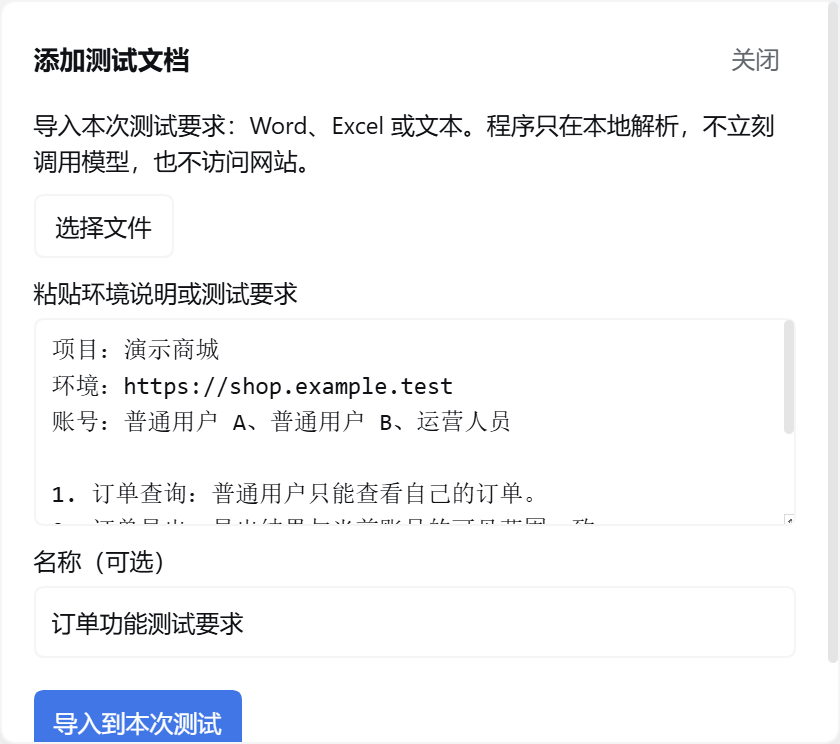
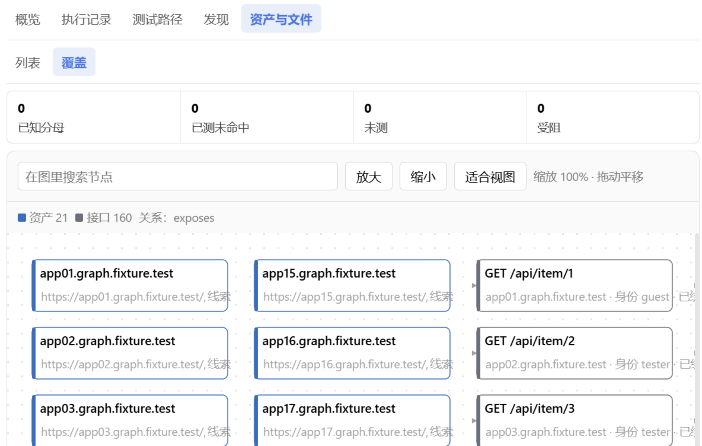

# Saker

**DeepSeek Harness Desktop 的个人安全审查工作台。** 在 dsh 会话中整理材料和问题，在 Saker 工作台里核对原件、记录判断、查看覆盖与用量，再预览交付报告。聊天上下文、原始记录和审查结论都能回到同一个任务。

[日常工作流](#一次审查怎么做) · [设计思路](#设计思路) · [使用环境](#使用环境) · [0.9.41 更新说明](docs/release-v0.9.41.md)

*新会话从原生输入框开始。测试流程、模块、指令模板和附件在同一条快捷栏中。*

## 为什么做 Saker

安全审查经常跨越几次会话。昨天看到的异常，今天需要重新核对它来自哪份材料、对应哪个版本、还有哪些条件没确认。Saker 把这部分工作留在桌面端，下一次打开任务时仍能沿原来的记录继续复核。

| 你已有的材料 | 可以从哪里开始 | 最后留下什么 |
| --- | --- | --- |
| 一份代码、一段已保存的请求或日志 | 在 dsh 会话中附上材料，说明希望核对的问题 | 原始材料、来源与版本，以及待复核的判断 |
| 一份环境说明和检查表 | 导入 Word、Excel 或文本，用原要求组织检查项 | 逐项结果、缺少的前置条件、相关记录 |
| 一条还没确认的发现 | 在“发现与证据”打开详情，按引用查看原件和历史 | 人工复核说明、更正记录、可预览的交付报告 |

## 一次审查怎么做

### 1. 在 dsh 里建立上下文

直接在空白会话描述问题，也可以先添加源码、已有报文或项目文档。指令模板可以选用、编辑和另存，内容进入原生输入框后由你发送。任务设置里可以检查本次范围、身份引用、资料开关和运行上限。

*导入时保留原要求和材料来源。缺少账号、环境或其他条件的检查项可以单独记录原因。*

### 2. 从发现追到证据，从覆盖图找到缺口

dsh 侧栏的 **Saker** 打开工作台。概览显示当前任务和待办。任务内可切换概览、执行记录、测试路径、发现、资产与文件；“隔天复核摘要”提供待核结论和原件入口。

- **测试路径**用实际保存的引用连接发现、原始记录和已有关联的回执，支持搜索和聚焦。
- **资产覆盖**按资产与接口查看已测、未测和受阻。缺少已知分母时，界面保留原始计数。
- **原件详情**显示归属和版本。历史请求可按保存时的版本打开，材料变动、失效和缺件有各自的状态提示。打开已保存原件是只读操作。

*资产覆盖页使用演示数据。它回答“检查了哪些入口”，测试路径回答“这条发现引用了什么”。*

### 3. 复核、对账，再交付

在发现详情的 **验证记录** 中，依据原件写下“依据足以支持”“依据不足”或“更正先前判断”。已有判断可回看，原件变化时界面会标出当前依据已失效。报告先预览再下载，记录变化后需要刷新预览；常见凭据字段在导出中会脱敏。

**执行记录 → 模型用量**可以逐轮查看已观察到的传输、已结算用量、缓存和未知项。任务额度和实际可观察用量各有口径。审查中值得复用的内容可整理成知识草稿，确认来源和适用条件后由用户保存。

## 设计思路

- **宿主提供会话，Saker 管理审查记录。** 以 dsh 的原生会话、模型设置、工作区和工具连接为入口。Saker 补上项目要求、证据归属、回执、复核和报告，把日常对话区与需要集中查看的记录分开。 [DeepSeek Harness](https://github.com/deepseek-ai/deepseek-harness)
- **借鉴 ARTEX 的信息分层。** 任务、执行、发现和资产是几种不同的阅读问题。Saker 把测试路径与覆盖分成两个视图，两者都能沿已保存的记录回到详情。 [ARTEX](https://github.com/ITroyeSivan/ARTEX)
- **借鉴 sapper-v2 复盘里的交接与记忆。** Saker 把可复核的历史落实为原件引用、版本、归属和人工判断。早期假设可以更正，后续读者可以查到更正前的依据。 [SapperLens 对 sapper-v2 的独立复盘](https://github.com/inwpu/SapperLens/blob/eebd7ce31c5d6620f1e760b80de774484568c94b/README.md)
- **把控制和计量留在程序里。** 范围、权限、停止及限额由宿主与插件检查。检查历史记录、切换证据和预览报告是只读操作，用量未知时保留未知状态。

## 使用环境

当前文档对应 **Saker 0.9.41**。可见验收范围为 Windows 上的官方 **dsh Desktop 0.2.2-rc.1**。安装维护脚本使用 **Node.js 24.9+**。正式 profile 的插件包存放在自身的持久目录，原有会话、模型设置、个人模板和 MCP 配置由宿主继续使用。 [官方 Desktop 版本](https://github.com/deepseek-ai/deepseek-harness/releases/tag/dsh-v0.2.2-rc.1)

Saker 面向自有或明确授权的安全审查。反馈时请提供版本、操作步骤和已脱敏的截图或日志。 [使用边界](docs/boundaries.md) · [问题反馈](https://github.com/ITroyeSivan/Saker/issues) · [MIT 许可证](LICENSE) · [第三方说明](THIRD_PARTY_NOTICES.md)

## 参考与致谢

- [ARTEX](https://github.com/ITroyeSivan/ARTEX)：借鉴任务、执行、发现和资产的信息分层，以及测试路径与覆盖分开的阅读方式。
- [sapper-v2](https://github.com/N1nEmAn/sapper-v2)：借鉴复盘中的交接、记忆与可追溯判断；可结合 [SapperLens 的独立复盘](https://github.com/inwpu/SapperLens/blob/eebd7ce31c5d6620f1e760b80de774484568c94b/README.md) 阅读。
- [DeepSeek Harness](https://github.com/deepseek-ai/deepseek-harness)：提供原生会话、模型、工作区与桌面插件基础。
