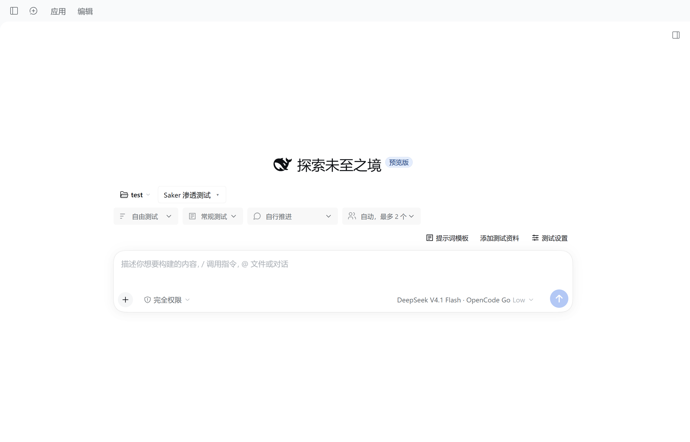
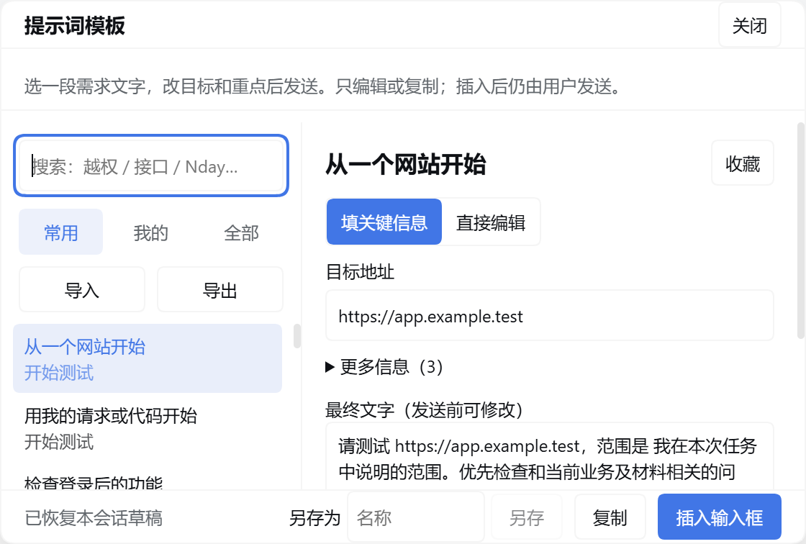
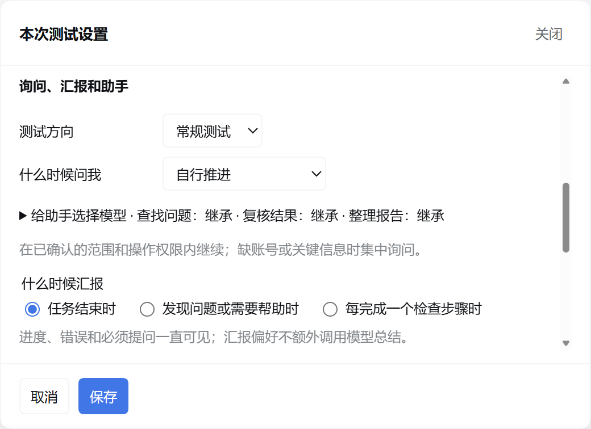
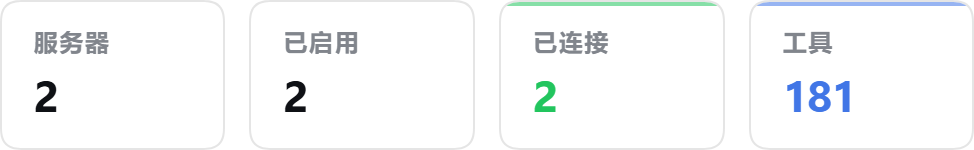
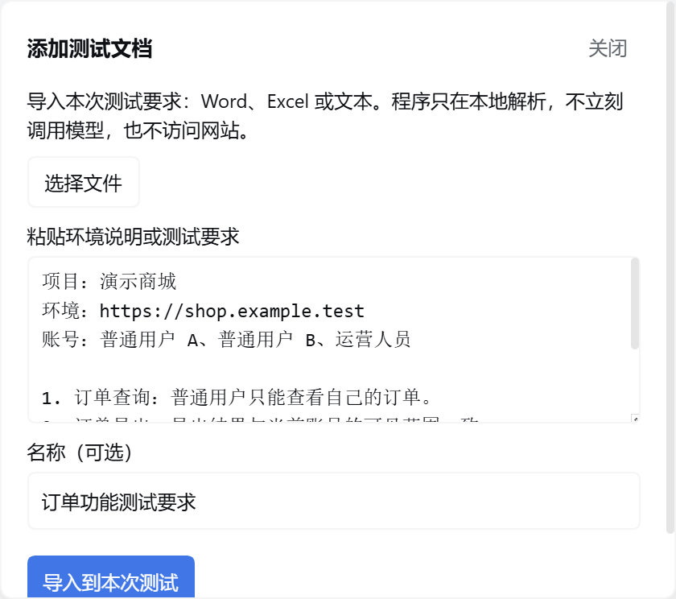

<h1 align="center">Saker</h1>

<p align="center"><strong>把你的安全测试思路，接到真实的浏览器和工具上。</strong></p>

<p align="center">
  <a href="https://github.com/ITroyeSivan/Saker/releases/latest"></a>
  
  
  <a href="LICENSE"></a>
</p>

<p align="center">
  <a href="https://github.com/ITroyeSivan/Saker/releases/latest">下载最新版</a> ·
  <a href="#从你的需求开始">使用场景</a> ·
  <a href="#界面与操作">界面预览</a> ·
  <a href="#安装与更新">安装与更新</a> ·
  <a href="docs/features.md">功能说明</a>
</p>



Saker 是 [DeepSeek Harness Desktop](https://github.com/deepseek-ai/deepseek-harness) 的安全测试插件。你提供目标、材料和想检查的问题，模型选择方法、工具与顺序；Saker 提供浏览器操作、外部工具接入、任务控制和结果整理。

从一个网址开始，整理整个授权域的资产，分析一段请求或代码，核对指定 CVE，或者照项目文档逐项测试，都在同一个聊天界面完成。无需先建立知识库，也不用按固定阶段走一遍。

当前版本 **0.5.1**。

> 正在快速迭代，仅供个人学习与授权实验，暂不建议用于生产环境或正式项目交付。

## 从你的需求开始

| 你想做什么 | 交给 Saker 什么 | 怎么开始 |
| --- | --- | --- |
| SRC 研究、授权资产排查 | 多个 URL、域名、通配子域、IP/CIDR、资产清单与排除项 | 选“自由测试”，说明授权范围和关注点；按需收集子域、端口、后台及接口 |
| 已知漏洞研究 | CVE、公告、产品版本、PoC 仓库或已有文件 | 直接说明要核对的漏洞，模型按需读取资料并判断适用条件 |
| 沿业务疑点深入分析 | 账号、HTTP 请求、JS、接口说明或源码 | 从已有材料直接开始，可随时补充思路、更换研究重点 |
| 项目文档测试 | 环境说明、测试要求、案例表或可访问的文档内容 | 选“按文档测试”，整理检查项、按依赖执行并保留原文出处 |

**常规测试、Nday 发现、0Day 挖掘是研究重点，不是工具白名单或固定流程。** 只有目标时可以先收集信息；已有请求、账号或具体问题时可以直接研究。

例如，你可以这样提出需求：

```text
整理 example.com 授权范围内的子域和 Web 入口，排除 pay.example.com。
结合我配置的 FOFA 查找遗漏的后台和登录入口，先整理候选与来源。
```

```text
阅读我给的 CVE 公告和 PoC 仓库，核对这批授权资产的产品与版本。
优先处理符合条件的入口，写清验证依据和仍不确定的地方。
```

```text
根据附件里的项目环境和测试要求逐项检查。
沿用我提供的账号；缺条件的项目写清原因，其他独立项目继续。
```

## 界面与操作

### 想好怎么测，再一键放进聊天框

“写提示词”提供按需求分类的示例，支持搜索、收藏、个人模板和直接编辑。填目标等关键信息后，复制或插入输入框；内容始终可改，插入不会自动发送。

模板由你选择，常驻层只保留必要的任务说明。CVE、公告、仓库和已有文件按需读取，不把整套知识和长篇流程塞进每轮请求。



### 在同一任务中调整范围、重点和协作方式

聊天上方只保留场景、添加文件、写提示词和设置。询问时机、汇报频率、助手人数与可选预算集中在设置中；可以自行推进，也可以在改动网站数据前等待确认。

运行中调整重点、范围或额度，沿用当前任务及累计记录。聊天里提出的扩大范围、增加额度或放开权限，会先列出变化供你确认。短任务由主代理完成，独立问题需要分工时再使用助手。



### 用真实浏览器测试，卡住时直接接手

受管 **Chrome for Testing + CDP** 支持页面观察、点击、填写、选择、上传、下载和弹窗处理。独立浏览器保留登录态与前端行为，Burp、Yakit 等 MCP 服务和本机工具按需配合。

需要本人登录、处理验证码或判断业务步骤时，点击“我来操作”。Saker 保留同一浏览器并暂停模型派发；点击“继续测试”后先观察最新页面，再继续原任务。



### 按文档逐项做，结果能追溯到要求

“按文档测试”保留环境说明与案例出处，把要求整理成检查项。执行时记录当前项目、动作和结果；缺少账号、数据或页面条件时写清具体缺口，继续处理独立项目。

检查表、问题、附件与历史运行可单独查看，也可导出离线交付包。中断后保留进度，结果未知的写操作先核对再决定是否重试。



### 过程、问题和材料各有入口

| 入口 | 你能看到什么 |
| --- | --- |
| **执行记录** | 已执行的调用、HTTP 回执、动作状态与任务用量 |
| **发现的问题** | 问题说明、复现材料、复核状态与待补证据 |
| **测试资料** | 原始文件、已有报文、JS、截图、下载文件及引用 |

已保存的文件不会整份自动进入每轮上下文；实际读取的内容才进入模型输入。发现记录引用材料，避免反复粘贴原文。任务状态中的“查看资产”等本地查看操作不调用模型。

## 本版更新

**v0.5.1 汇总了 v0.4.113 之后的全部改进：**

- 重组为自由测试与按文档测试，减少固定步骤和无关工具声明。
- 多目标、域名、通配子域、IP/CIDR 与排除项统一使用；普通探索可直接执行并保存请求、响应。
- 资产平台被动查询与目标主动访问分开，保留查询条件、候选来源及分页进度。
- 同一任务支持调整范围、重点、协作方式和预算，继续时保留累计记录。
- 自由测试接入受管浏览器与人工接管，完善文档读取、项目恢复、归档和离线交付。
- 移除公共知识库、Nday 资料库及固定步骤编排入口；资料改为由任务按需读取。

完整说明见 [v0.5.1 更新日志](docs/release-v0.5.1.md)。

## 安装与更新

适用于官方 Windows **DeepSeek Harness Desktop 0.2.1-rc.2**，兼容 **0.2.0-rc.2**。脚本需要 Node.js **22.19 及以上的 22.x，或 24 及以上版本**。

1. 安装并打开 [官方 Desktop](https://github.com/deepseek-ai/deepseek-harness/releases/tag/dsh-v0.2.1-rc.2)，完成初始化与模型配置，再完全退出应用。
2. 下载并解压 [最新发布包](https://github.com/ITroyeSivan/Saker/releases/latest)中的 `Saker-0.5.1-desktop.zip`。
3. 在解压目录打开 PowerShell，指定官方 Desktop 的实际安装目录：

```powershell
node scripts/install-desktop.mjs --desktop-dir "C:/path/to/DeepSeek Harness" --check
node scripts/install-desktop.mjs --desktop-dir "C:/path/to/DeepSeek Harness"
```

4. 双击桌面的 **Saker (dsh Desktop)**，新建会话并选择 **Saker 渗透测试**。

升级使用同一命令，保留会话、模型、账号与 MCP 配置，并刷新桌面快捷方式。**安装后保留解压目录中的 `dist/desktop`**，其中包含已安装插件引用的包文件。模型服务、本机工具和资产平台按需要自行配置。

源码安装、浏览器配置和回退方法见 [安装指南](docs/getting-started.md)。

## 使用说明

Saker 正在快速迭代，目前仅供个人学习与授权实验，暂不建议用于生产环境或正式项目交付。仅在本人环境或明确授权范围内使用；分享报告和材料前，请检查其中的账号、Cookie、Token 与源码。

Saker 自有代码采用 [MIT](LICENSE)。第三方规则与内容遵循各自许可证，详见 [第三方说明](THIRD_PARTY_NOTICES.md)。
