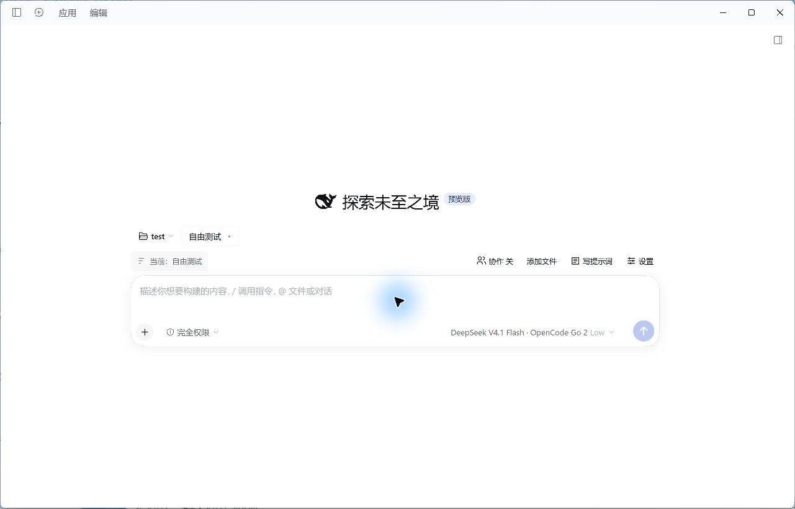
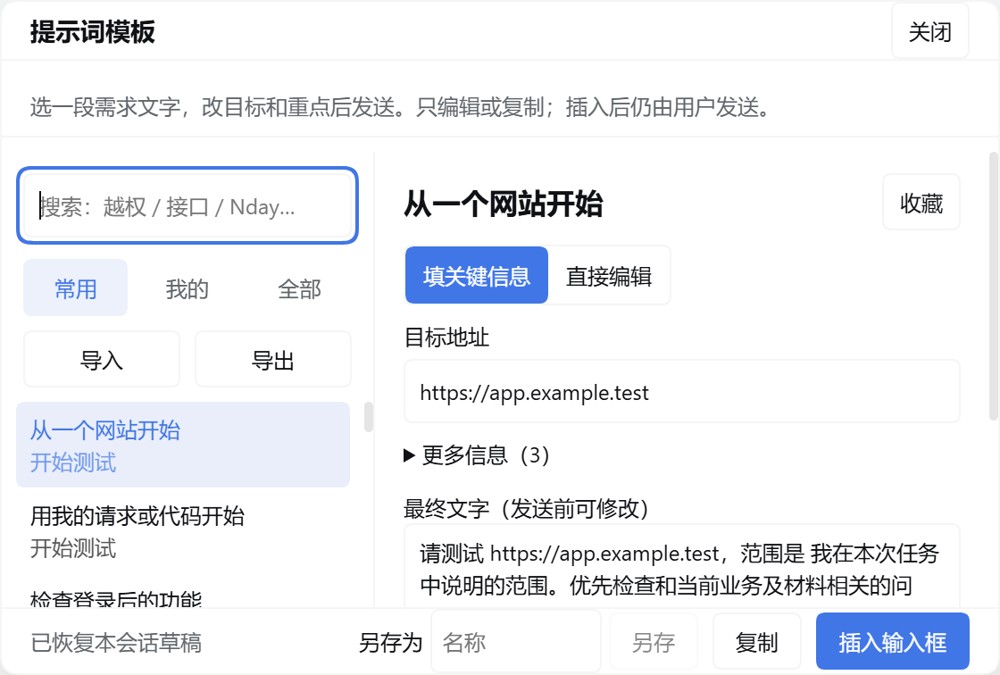
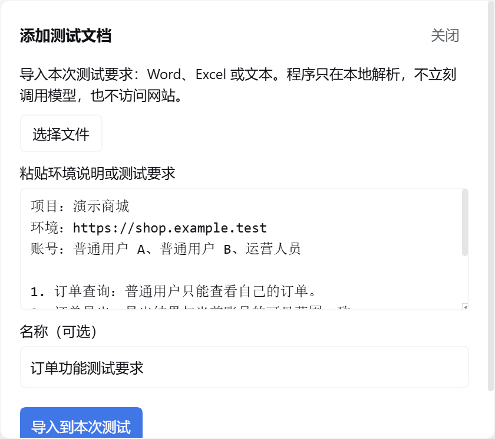
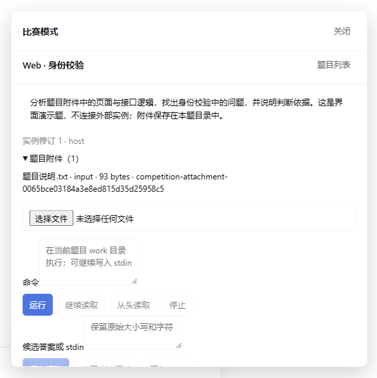
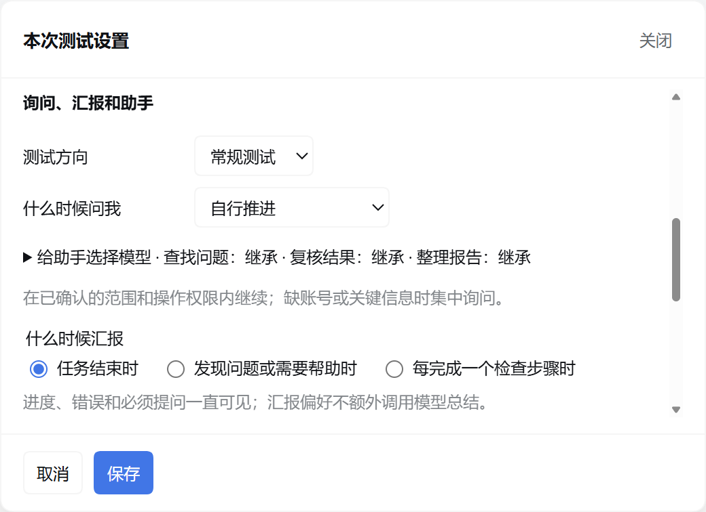

<h1 align="center">Saker</h1>

<p align="center"><strong>把你的安全测试思路，接到真实的浏览器和工具上。</strong></p>

<p align="center">
  <a href="https://github.com/ITroyeSivan/Saker/releases/latest"></a>
  
  
  <a href="LICENSE"></a>
</p>

<p align="center">
  <a href="https://github.com/ITroyeSivan/Saker/releases/latest">下载最新版</a> ·
  <a href="#三种场景一个聊天入口">使用场景</a> ·
  <a href="#界面与操作">界面预览</a> ·
  <a href="#安装与更新">安装与更新</a> ·
  <a href="docs/release-v0.6.1.md">更新日志</a>
</p>

Saker 是 [DeepSeek Harness Desktop](https://github.com/deepseek-ai/deepseek-harness) 的安全测试插件。你提供目标、材料和想检查的问题，模型选择方法、工具与顺序；Saker 负责浏览器操作、工具接入、按需协作，以及执行过程和结果的保存。

当前版本 **0.6.1**。

从一个网址、整批授权资产、已有报文或源码开始，研究指定 CVE，按项目文档逐项检查，或围绕比赛题目解题，都能在同一界面进行。信息收集按需开展，已有线索可以直接研究，不必先走固定流程。

> 项目正在快速迭代，仅供个人学习与授权实验，暂不建议用于生产环境或正式项目交付。



## 三种场景，一个聊天入口

新会话选择 **Saker**，再选择适合当前工作的场景。

| 场景 | 适合的需求 | 常用内容 |
| --- | --- | --- |
| **自由测试** | SRC 研究、授权资产排查、已知漏洞验证、业务逻辑与源码分析 | 网址、域名、资产清单、账号、报文、JS、源码、CVE 或仓库链接 |
| **案例测试** | 按项目环境说明和既有案例逐项检查 | Word、Excel、文本和文档导出内容，检查表、缺少条件、历史与重测 |
| **比赛模式** | CTF 单题研究、多题分工、本地或离线解题 | 题面、附件、实例、命令进程、原始输出、候选答案和可选本地资料 |

**常规测试、Nday 发现、0Day 挖掘是研究重点，不是工具白名单或必经阶段。** 只有目标时可以先收集信息；已有请求、账号或疑点时可以直接开始。多个网址、通配子域、IP/CIDR 和排除项都可以表达。

```text
整理 example.com 授权范围内的子域和 Web 入口，排除 pay.example.com。
结合已配置的 FOFA 查找遗漏的后台和登录入口，保留候选与来源。
```

```text
阅读我给的 CVE 公告和 PoC 仓库，核对这批授权资产的产品与版本。
优先检查符合条件的入口，说明实际依据和仍需核对的地方。
```

```text
按附件中的项目环境和 Excel 案例逐项检查，沿用我提供的账号。
缺条件的项目写清原因，继续执行其他独立项目。
```

## 界面与操作

### 提示词由你决定

“写提示词”提供可搜索、可修改的需求示例，支持收藏和个人模板。改好目标、账号与重点后，复制或插入聊天框；插入不会自动发送。示例按需选用，公告、仓库、附件和参考资料按需读取。



### 按文档检查，逐项查看

案例测试读取环境说明和案例要求，保留原文出处，按要求执行。聊天区显示当前进度；检查表集中展示测试要求、执行情况、结论和说明。长说明先看预览，需要时打开详情，完整记录可导出。

暂停、关闭应用、查看历史或重测某一项，各自保留对应的运行记录。缺账号、缺数据等条件单独列出，其他独立项继续；写操作结果不确定时先核对，避免重复提交。



### 比赛围绕题目工作

题面、附件和实例按题保存。每次命令执行分别保留输入、输出和进程状态，可继续读取长输出或向交互进程输入内容。候选答案与通过状态分开，是否通过由用户或平台确认。

比赛本地资料默认关闭，需要离线参考时再启用并导入。支持本机执行；Docker 使用本地已有环境与镜像，不自动下载镜像。多个请求共用本地模型服务时，按配置控制并发。



### 连续研究，需要时再协作

补充账号、换一个疑点、调整优先级，直接在当前聊天中说明。普通回答结束后仍可接着工作，不必反复发送固定的“继续”指令。短任务由当前模型完成，需要独立调查或复核时再启用助手。

设置集中管理授权范围、排除项、询问时机、汇报频率、助手和可选预算。调整额度保留已用量；查看、筛选和导出已有记录不调用模型。



### 浏览器与实际工具配合

使用独立 **Chrome for Testing + CDP** 操作真实页面，保留登录态与前端行为。需要本人登录或处理页面时，点击“我来操作”；完成后继续原任务。Burp、Yakit 等 MCP 服务、本机扫描工具和 FOFA、Hunter、Quake 资产平台按需接入。

工具调用、实际返回和可见答复由程序保存，模型不必另做登记。结果页按“执行记录 / 发现的问题 / 测试资料”查看，方便回到原请求、输出和文件核对依据。工具随场景收窄，不默认启动一整组代理。

## 安装与更新

需要 **Windows 10/11**、官方 DeepSeek Harness Desktop，以及 **Node.js 22.19 及以上的 22.x，或 24 及以上版本**。当前支持 Desktop **0.2.1-rc.5**，保留 **0.2.1-rc.2、0.2.0-rc.2** 兼容。

1. 安装并打开 [官方 Desktop](https://github.com/deepseek-ai/deepseek-harness/releases/tag/dsh-v0.2.1-rc.5)，完成初始化与模型配置，然后完全退出应用。
2. 从 [Releases](https://github.com/ITroyeSivan/Saker/releases/latest) 下载 `Saker-0.6.1-desktop.zip` 并解压。
3. 在解压目录运行，将路径替换成实际应用目录：

```powershell
node scripts/install-desktop.mjs --desktop-dir "C:/path/to/DeepSeek Harness" --check
node scripts/install-desktop.mjs --desktop-dir "C:/path/to/DeepSeek Harness"
```

安装器先备份配置，再通过官方命令安装 **15 个插件和根包**，保留会话、账号、个人模板、浏览器和 MCP 配置，并更新桌面的 **Saker (dsh Desktop)** 快捷方式。升级会移除已退役的插件，保留历史数据。

**安装后保留解压目录，尤其是 `dist/desktop`。** 已安装插件会引用其中的包文件。模型、本机工具和外部服务需要按自己的环境配置；比赛题目附件不受本地资料开关影响。

详细步骤见 [安装与首次配置](docs/getting-started.md)，功能说明见 [功能文档](docs/features.md)，组件见 [插件清单](docs/plugin-list.md)。

## 使用说明

仅在拥有或已明确授权的环境中使用。导出的请求、截图和文件可能包含业务内容，分享前请检查账号、Cookie、Token 和个人信息。执行记录用于核对事实，漏洞与比赛答案仍以实际复现和确认结果为准。

Saker 自有代码采用 [MIT](LICENSE)。第三方内容遵循各自许可证，见 [第三方说明](THIRD_PARTY_NOTICES.md)。
