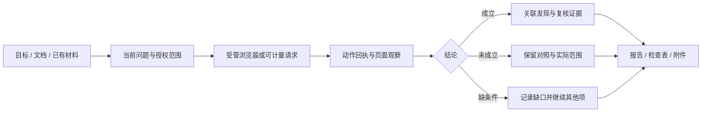
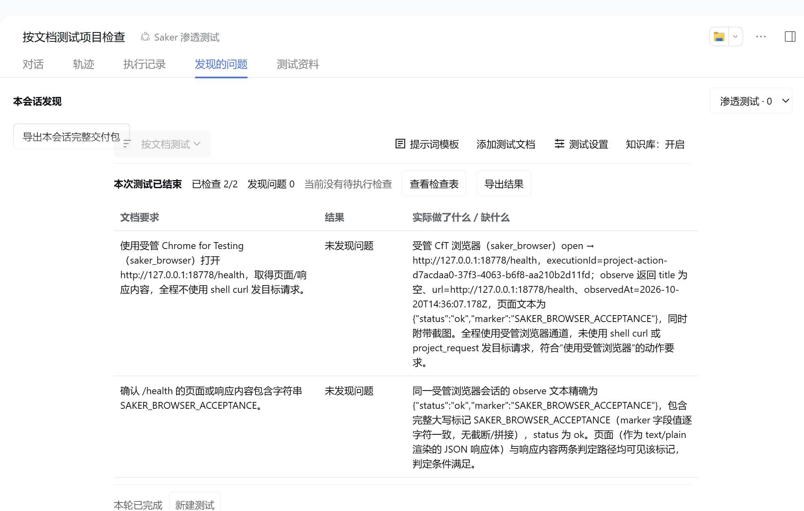
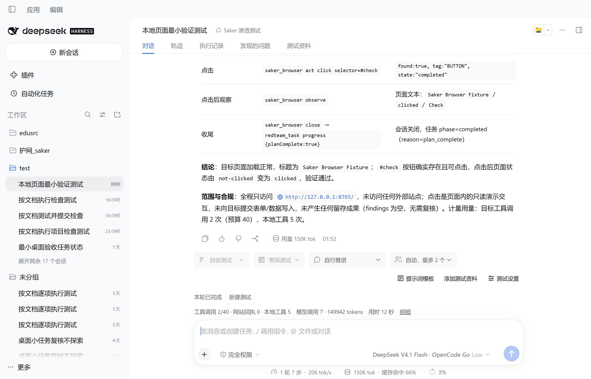

<p align="center">
  
</p>

<h1 align="center">Saker · 让安全测试留下证据</h1>

<p align="center"><strong>自由测试，按文档执行，受管浏览器，可恢复交付。一个对话完成整条工作流。</strong></p>

<p align="center">
  <a href="https://github.com/ITroyeSivan/Saker/releases/latest"></a>
  
  
  
</p>

<p align="center">
  <a href="https://github.com/ITroyeSivan/Saker/releases/latest"><strong>下载</strong></a>
  ·
  <a href="docs/getting-started.md">安装</a>
  ·
  <a href="docs/features.md">功能</a>
  ·
  <a href="docs/boundaries.md">边界</a>
  ·
  <a href="https://github.com/ITroyeSivan/Saker/issues">反馈</a>
</p>

Saker 是运行在 [DeepSeek Harness Desktop](https://github.com/deepseek-ai/deepseek-harness) 上的安全测试工作台。你直接给目标、文件、CVE、仓库或具体疑点，模型自行判断下一步；Saker 负责提供真实工具、约束访问范围，并把每次检查、请求、截图、结论和缺口留在同一任务里。

## 这一版有什么不同

| 不再需要 | 现在怎么做 |
| --- | --- |
| 先建公共知识库、等资料同步 | 直接给 CVE、公告、仓库或文件；需要时联网读取，不再维护本地情报目录 |
| 先选固定方法模块、走固定链路 | 自由测试由模型按当前事实选择方式；程序只保留授权、预算、暂停和证据约束 |
| 在聊天记录里翻“到底做没做” | 检查项绑定真实动作、页面观察或请求回执，缺口不会被伪装成通过 |
| 用 curl 猜浏览器结果 | 目标站点优先走受管 Chrome for Testing / CDP，保留浏览器 Cookie、重定向、脚本和页面状态 |

## 两个清楚的工作起点

### 自由测试

从地址、账号、请求、JS、源码或扫描结果直接开始。常规测试、Nday 发现和 0Day 挖掘是方向偏好，不是三套互相隔离的硬流程。资产平台、扫描器、浏览器和带外验证按当前问题出现，不把整套工具清单塞进每一轮。

### 按文档测试

导入 Word、Excel、文本或粘贴环境说明。Saker 读取原文、保留位置和修订，把要求整理成检查项，再逐项执行。某个账号、对象或页面确实缺失时记录缺口，其他独立项继续；结束后可以查看检查表、发现、附件和离线交付包。



## 工作台不是一个黑盒

### 检查项有去向

每条要求都保留来源、位置、执行状态、实际动作和结论。完整阴性需要当前任务的真实动作或明确复用观察；问题结论要关联可复核的发现。暂停、冷启动和恢复不会清零预算，也不会盲目重放未知写入。



### 浏览器验证保留页面语义

Saker 使用独立 Chrome for Testing，通过 CDP 打开、观察、点击、填写、上传下载、处理弹窗并读取相关请求。目标范围、排除路径、身份和并发限制在请求发出前检查。浏览器目录可在 **应用设置 → 安全配置 → 工具 → Chrome for Testing** 修改。




### 结果、材料和用量分开

- **执行记录**：工具调用、模型调用、动作状态和目标回执。
- **发现的问题**：问题说明、复现材料、复核状态和待补证据。
- **测试资料**：原始文档、请求、响应、截图、下载和项目来源。
- **用量明细**：工具、模型、Token、缓存读取和实际耗时分开显示。

“未发现问题”只针对已记录的执行范围。“需进一步确认”“缺少条件”“部分完成”和“不适用”不会被合并成完整安全结论。


## 0.5.0 重点

- **移除知识库与 Nday 资料库/采集链**：不再安装、激活或后台同步相关插件，不再把公开语料随包分发。
- **直接使用公开信息**：CVE、公告、仓库和 EXP 由模型按任务需要读取，不要求先导入本地目录。
- **场景入口更清楚**：新会话明确区分“自由测试”和“按文档测试”；方向偏好不再构成工具权限。
- **工具面按需收窄**：资产发现、主动扫描和依赖任务按场景加载，核心证据记录始终可用。
- **带外验证迁入扫描工具**：`oob_probe` 继续支持新建标识、批量归因、平台回查和明确失败，不再依赖 Nday 插件。
- **界面与恢复整理**：移除旧知识入口、固定 17 项清单和旧流程控件，保留范围、身份、预算、暂停、恢复和交付。

完整变化见 [0.5.0 发布说明](docs/release-v0.5.0.md)。

## 安装

当前版本 **0.5.0**，适用于官方 Windows Desktop **0.2.1-rc.2**，兼容 **0.2.0-rc.2**。

1. 安装官方 Desktop，完成初始化和模型配置，然后完全退出应用。
2. 下载 `Saker-0.5.0-desktop.zip` 并解压到长期保留的目录。
3. 在解压目录打开 PowerShell：

```powershell
node scripts/install-desktop.mjs --desktop-dir "C:/path/to/DeepSeek Harness" --check
node scripts/install-desktop.mjs --desktop-dir "C:/path/to/DeepSeek Harness"
```

安装器通过官方桌面命令完成事务安装，保留用户数据、会话、模型配置、MCP 和插件选择，并刷新桌面上的 **Saker (dsh Desktop)** 快捷方式。需要 Node.js 22.19 及以上的 22.x，或 24 及以上版本。

详细升级、Web profile、回退和卸载说明见 [安装指南](docs/getting-started.md)。

## 使用边界

Saker 面向个人学习、授权实验和安全研究，暂不建议直接用于生产环境或未经复核的正式项目交付。

- 只对本人环境或已明确授权的目标使用。
- 模型和工具可能误判；关键结论要结合原始请求、身份和业务对象复核。
- 配置、任务材料和导出包可能含 Token、Cookie、报文和源码，分享前请检查。
- 严格 token 硬预算依赖宿主完整计量每次模型传输；无法可靠计量时会明确限制，不做虚假承诺。

Saker 自有代码采用 [MIT](LICENSE)。代码审计规则中的第三方内容按各自许可证分发，详见 [第三方说明](THIRD_PARTY_NOTICES.md)。
