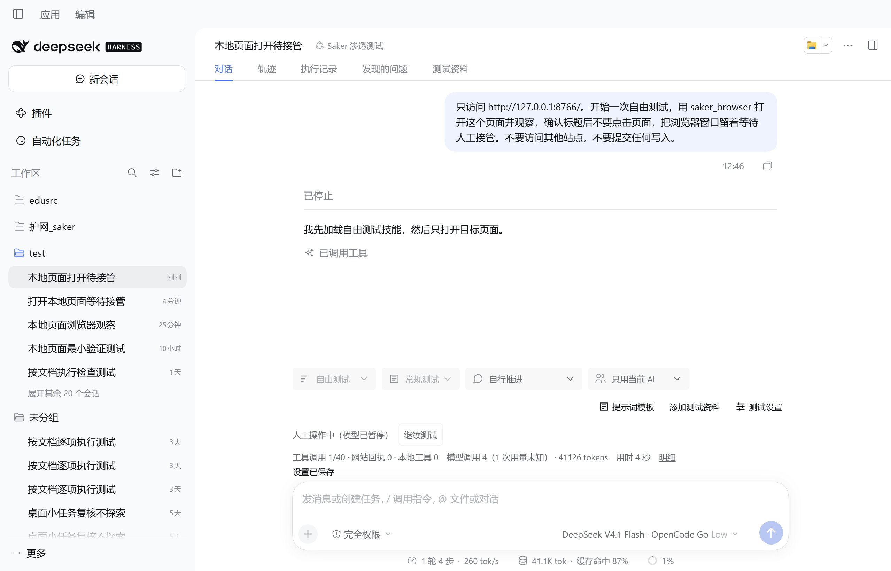
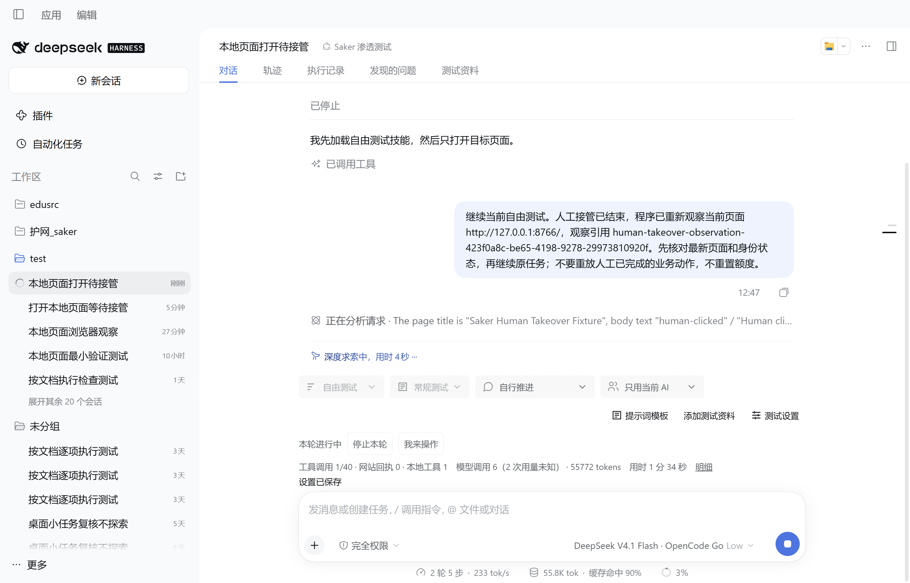

<p align="center">
  
</p>

<h1 align="center">Saker</h1>

<p align="center"><strong>让安全测试留下可核对的动作、页面状态和交付证据。</strong></p>

<p align="center">
  
  
  
</p>

<p align="center">
  <a href="#为什么是-saker">亮点</a> ·
  <a href="#两种工作起点">工作方式</a> ·
  <a href="#开始使用">安装</a> ·
  <a href="docs/features.md">功能说明</a> ·
  <a href="docs/boundaries.md">使用边界</a>
</p>

Saker 是运行在 [DeepSeek Harness Desktop](https://github.com/deepseek-ai/deepseek-harness) 上的安全测试工作台。你直接给目标、文档、CVE、仓库、请求或具体疑点，模型决定怎么查；Saker 负责真实执行、范围约束、暂停恢复和证据交付。

## 为什么是 Saker

| 真正的问题 | Saker 的做法 |
| --- | --- |
| “模型说测过了”，但找不到实际动作 | 检查项绑定工具回执、页面观察或请求记录，未执行和缺条件不会被写成通过 |
| 先建库、选模块、填表单，还没开始就绕远 | 地址、文件、CVE、EXP 和已有请求直接进入测试 |
| curl 看不到登录态、脚本和前端跳转 | 目标网页优先使用受管 Chrome for Testing / CDP，保留浏览器语义 |
| 一开子代理和固定流程，成本和不可控一起上升 | 单一主流程，按当前事实使用工具；暂停、预算和范围由程序约束 |
| 中断后重放未知写入，或继续时额度被清零 | 未知动作先核对；继续保留原预算、身份和证据归属 |
| 页面操作卡住时用户无法接手 | 可在状态行点击“我来操作”，保留同一浏览器；用户操作后先重新观察再继续 |

## 两种工作起点

### 自由测试

从网站、请求、JS、源码、CVE、公告或扫描结果直接开始。常规测试、Nday 发现和 0Day 挖掘只是方向偏好，不是三套互不相通的硬流程。

资产平台、扫描器、浏览器和带外验证按需出现。模型能看到当前任务、授权范围、身份和预算，但不会被固定方法清单替代判断。


### 按文档测试

导入 Word、Excel、文本，或直接粘贴环境说明和测试要求。Saker 保留原文位置与修订，把要求整理为检查项，再按依赖顺序执行。

缺少账号、对象或页面条件时记录具体缺口，独立项继续。检查结束后可以查看检查表、问题、附件和离线交付包。


## 页面与证据在一起

受管浏览器支持打开、观察、点击、填写、选择、上传、下载和弹窗处理，并保存页面观察、请求摘要和相关附件。出现需要本人登录、验证码或业务判断的步骤时，可以直接人工接管。

人工操作使用同一浏览器和身份；模型派发在新请求前被拦截。点击“继续测试”后，程序先重新观察最新页面，再把结果交回原任务，不重放用户已完成的业务动作。






## 看得见的边界

- **执行记录**：工具调用、动作状态、请求回执和模型用量分开记录。
- **发现的问题**：问题说明、复现材料、复核状态和待补证据分开显示。
- **测试资料**：原始文档、请求、响应、截图和下载都保留引用。
- **暂停恢复**：暂停不丢进度；未知写入先核对；继续不清零预算。
- **浏览器路径**：可在 **应用设置 → 安全配置 → 工具 → Chrome for Testing** 指定独立浏览器目录。

“未发现问题”只对已记录的执行范围成立。“待确认”“缺少条件”“部分完成”和“不适用”不会被合并成完整安全结论。

## 0.5.0 源码变化

- 知识库、Nday 资料库、采集雷达和固定步骤编排退出产品运行路径。
- 新会话明确区分“自由测试”与“按文档测试”。
- 自由测试可以直接使用受管浏览器，不再伪造项目检查或 checkId。
- 新增浏览器人工接管：保留页面，暂停模型派发，人工操作后先观察再续作。
- 工具面按场景收窄；核心范围、身份、预算、暂停、恢复和交付能力保留。
- Chrome for Testing 使用独立窗口和独立 profile；非人工接管场景仍受请求范围和配额约束。

> **版本状态**：当前版本 **0.5.0** 仍是源码验收版。上一版公开发布标签和 Release 已撤回；在重新验收完成前，请勿引用旧发布附件或把当前源码当作已发布成品。

## 开始使用

适用于官方 Windows Desktop **0.2.1-rc.2**，兼容 **0.2.0-rc.2**。

1. 安装官方 Desktop，完成初始化和模型配置后完全退出应用。
2. 在当前源码目录安装依赖并生成安装包：

```powershell
pnpm install
node scripts/pack-all.mjs
```

3. 通过官方 Desktop 自带 CLI 安装到当前用户 profile：

```powershell
node scripts/install-desktop.mjs --desktop-dir "C:/path/to/DeepSeek Harness" --check
node scripts/install-desktop.mjs --desktop-dir "C:/path/to/DeepSeek Harness"
```

安装器会保留会话、账号、模型配置、MCP 和用户插件选择，并刷新桌面上的 **Saker (dsh Desktop)** 快捷方式。需要 Node.js 22.19 及以上的 22.x，或 24 及以上版本。

详细升级、Web profile 和卸载说明见 [安装指南](docs/getting-started.md)。

## 使用边界

Saker 面向个人学习、授权实验和安全研究，暂不建议直接用于生产环境或未经复核的正式项目交付。

- 只对本人环境或已明确授权的目标使用。
- 模型和工具可能误判；关键结论要结合原始请求、身份和业务对象复核。
- 配置、任务材料和导出包可能含 Token、Cookie、报文和源码，分享前请检查。
- 严格 token 硬预算依赖宿主完整计量每次模型传输；无法可靠计量时明确显示限制，不做虚假承诺。

Saker 自有代码采用 [MIT](LICENSE)。扫描规则中的第三方内容按各自许可证分发，详见 [第三方说明](THIRD_PARTY_NOTICES.md)。
