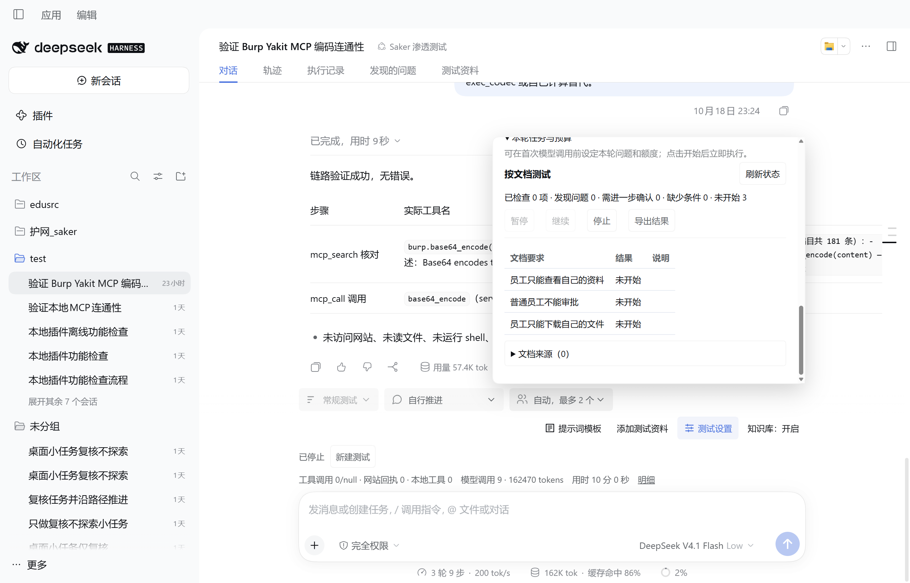
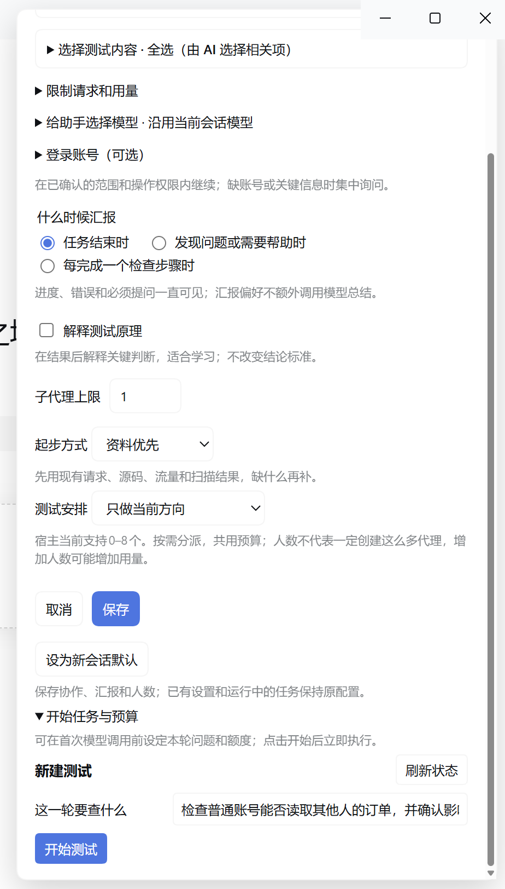
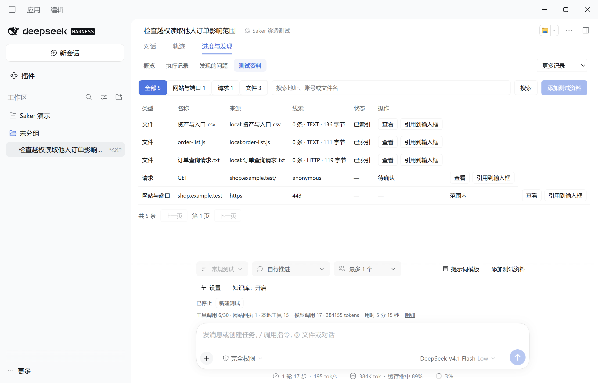
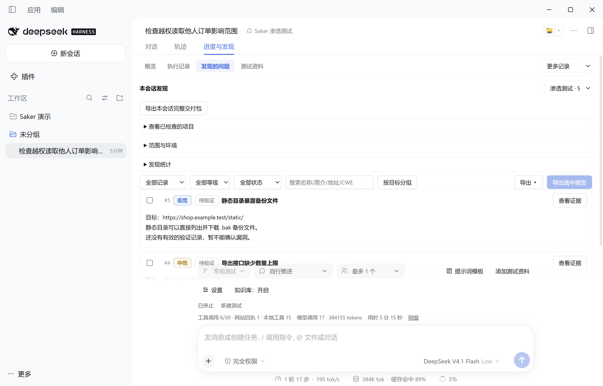
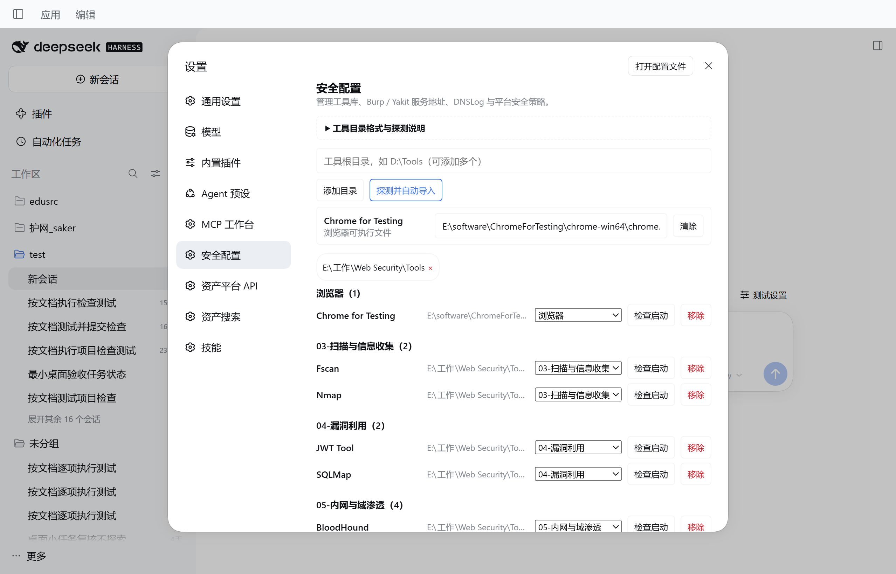
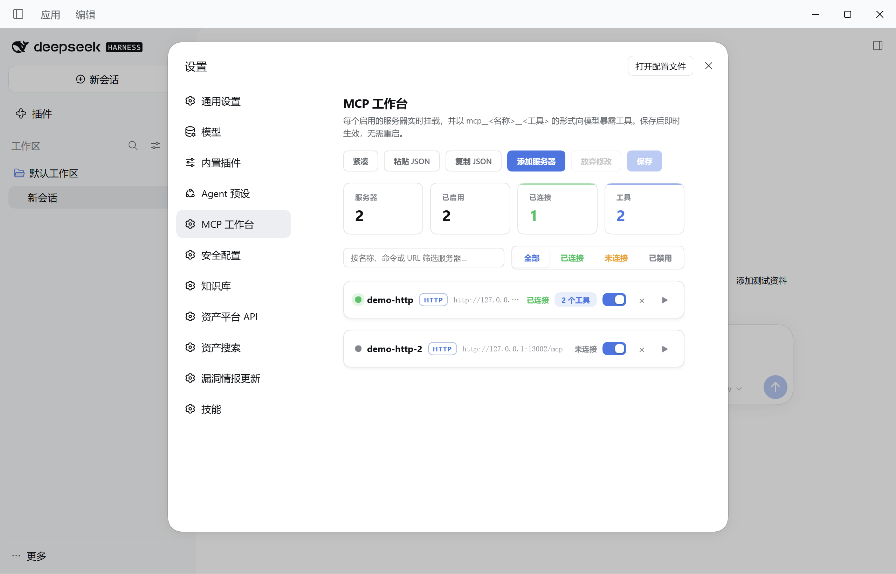

<p align="center">
  
</p>

<h1 align="center">Saker · 猎隼</h1>

<p align="center"><strong>围绕具体问题测试网站，也能按已有文档逐项检查。</strong></p>

<p align="center">
  <a href="https://github.com/ITroyeSivan/Saker/releases/latest"><strong>下载最新版</strong></a>
  ·
  <a href="docs/getting-started.md">安装说明</a>
  ·
  <a href="docs/features.md">功能说明</a>
  ·
  <a href="docs/boundaries.md">使用说明</a>
  ·
  <a href="https://github.com/ITroyeSivan/Saker/issues">问题反馈</a>
</p>

Saker 是运行在 [DeepSeek Harness Desktop](https://github.com/deepseek-ai/deepseek-harness) 上的安全测试插件。聊天、测试文档、浏览器操作、执行记录和发现的问题都保存在同一个会话里。

你提供目标、账号、资料和想查的问题，模型负责分析与选择下一步，Saker 提供工具、记录和任务控制。需要说明需求时，可从提示词模板开始修改；知识库按相关内容查阅，不把整套测试教程塞进每轮对话。

## 主要功能

| 你真正需要的能力 | Saker 的做法 |
| --- | --- |
| **按已有要求检查** | 本地读取 `.docx`、`.xlsx` 和文本，保留段落、单元格位置及修订；模型据此整理检查项 |
| **按自己的节奏使用** | 实战任务可选择自主推进或关键节点确认；项目任务按检查项推进，遇到缺条件的项目记录原因 |
| **查看执行过程** | 分开查看工具调用、模型调用、请求回执和已保存结果，停止后继续查阅 |
| **操作真实页面** | 连接独立 Chrome for Testing，观察页面、点击、填写表单并读取浏览器请求 |
| **复核和整理结果** | 保存问题、复现说明、请求与证据引用，导出报告和检查表供复核 |

## 两种工作起点

### 按文档测试

在聊天顶部选择 **按文档测试**，添加环境说明和测试要求后开始。环境与用例可以混在同一文件里，不要求使用固定表头。云文档暂时无法直接读取时，先导出文件或粘贴正文。

1. 文档先在本地完成解析，显示可读段落、位置和解析警告。
2. 模型读取来源后，把要求、参考材料和不可读区域分别整理。
3. 按检查项调用工具，保存结果、执行记录和缺少的条件。
4. 查看正在进行、已结束和等待补充条件的项目，必要时暂停或停止。
5. 从已保存记录导出报告、检查表和来源清单，导出本身不重新访问目标。

上图展示官方 Desktop 中的一次浏览器检查和结束后的结果。

### 实战挖掘

面向 SRC 挖掘和护网等任务的学习场景，保留 **常规测试、Nday 发现、0Day 挖掘** 三个子模式。可以先收集子域名、端口和入口，也可以根据已有账号、接口或报文直接检查。

例如：“使用提供的两个测试账号，检查普通用户能否读取另一人的订单。先复现正常查询，再比较权限检查结果。”提示词模板支持搜索、编辑、复制和插入输入框，发送前由你确认最终文字。



## 从资料到交付

| 阶段 | 你能看到什么 |
| --- | --- |
| 添加资料 | 文件、请求、HAR、curl、JS 和扫描结果按类型保存；查看不等于模型已读 |
| 开始任务 | 明确目标、允许访问的范围、排除路径、速率、额度和协作方式 |
| 连续检查 | 当前检查、已完成内容、关键缺口、身份与目标请求回执 |
| 复核结果 | 正常对照、异常观察、对象归属和待补证据 |
| 导出结果 | 从已保存记录生成 Markdown 报告、检查表和来源清单 |





## 真实浏览器与工具

浏览器操作使用独立 Chrome for Testing。浏览器目录可在 **应用设置 → 安全配置 → 工具** 中修改。

目标请求优先走受管浏览器或 Saker 的可计量请求入口；命令行 curl 不作为默认验证方式，因为它容易漏掉浏览器自动添加的头、Cookie、重定向和实际页面状态。

可接入 Burp、Yakit 和其他 MCP 服务；使用前需启动对应服务并完成配置。





## 查看结果

- **执行记录**：查看工具与模型调用，追查对应的请求回执。
- **发现的问题**：查看问题说明、复现材料和待补充的证据。
- **测试资料**：查找本次添加的文件、请求和相关资料。
- **用量明细**：查看模型调用、Token 和工具用量；缓存读取与新增生成的费用不同。

任务结束表示本轮流程结束；是否覆盖了业务要求、问题是否成立，仍需结合记录复核。

## 安装

当前版本 **0.4.112**，适用于官方 Windows Desktop **0.2.1-rc.2**，同时兼容 **0.2.0-rc.2**。

1. 安装官方 Desktop，完成初始化和模型配置，然后完全退出应用。
2. 下载 `Saker-0.4.112-desktop.zip`，解压到长期保留的目录。
3. 在解压目录打开 PowerShell：

```powershell
node scripts/install-desktop.mjs --desktop-dir "C:/path/to/DeepSeek Harness"
```

安装器会调用官方桌面命令，在一个事务中安装 20 个包，并保留原来的用户数据、会话、插件选择和 MCP 配置。更新后从桌面的 **Saker (dsh Desktop)** 快捷方式启动，不需要记命令行。

需要 Node.js 22.19 及以上的 22.x，或 24 及以上版本，与根包声明一致。详细升级、Web profile、回退和卸载步骤见 [安装说明](docs/getting-started.md)。

## 项目状态

Saker 正在快速迭代，目前仅供个人学习与授权实验，暂不建议用于生产环境或正式项目交付。

扫描器和模型都可能误判；涉及真实系统的处置应由安全人员复核。配置和任务产物可能包含 Token、Cookie、请求报文和源码，公开日志或截图前请脱敏。

Saker 自有代码采用 [MIT](LICENSE)，随附资料许可见 [第三方说明](THIRD_PARTY_NOTICES.md)。
